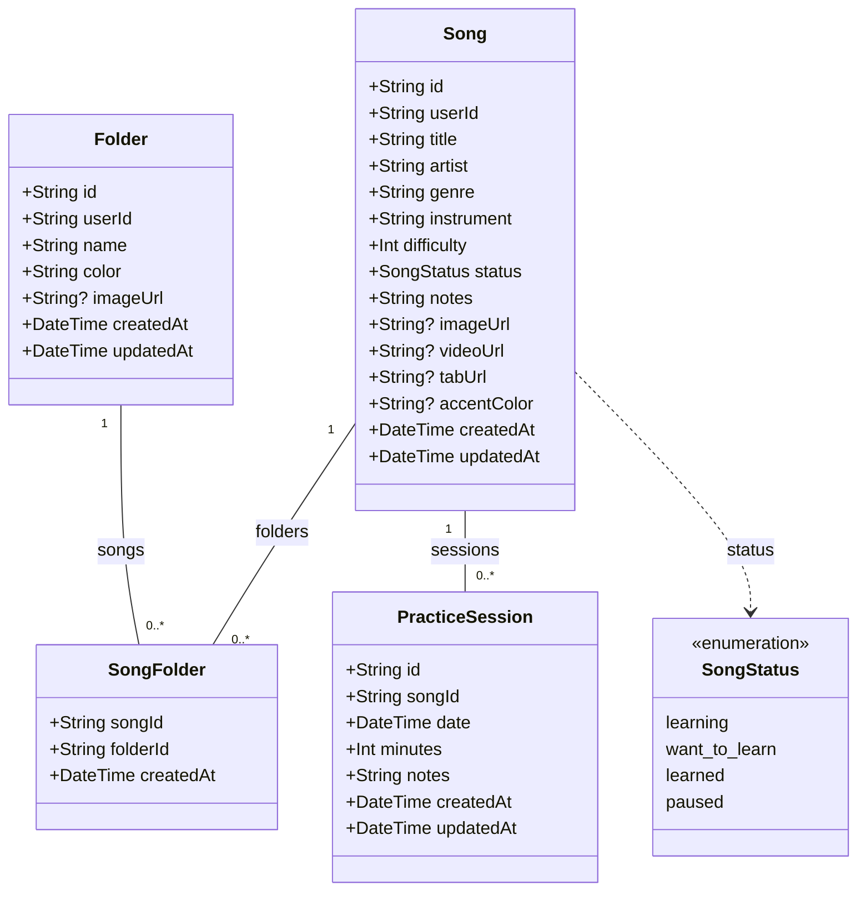
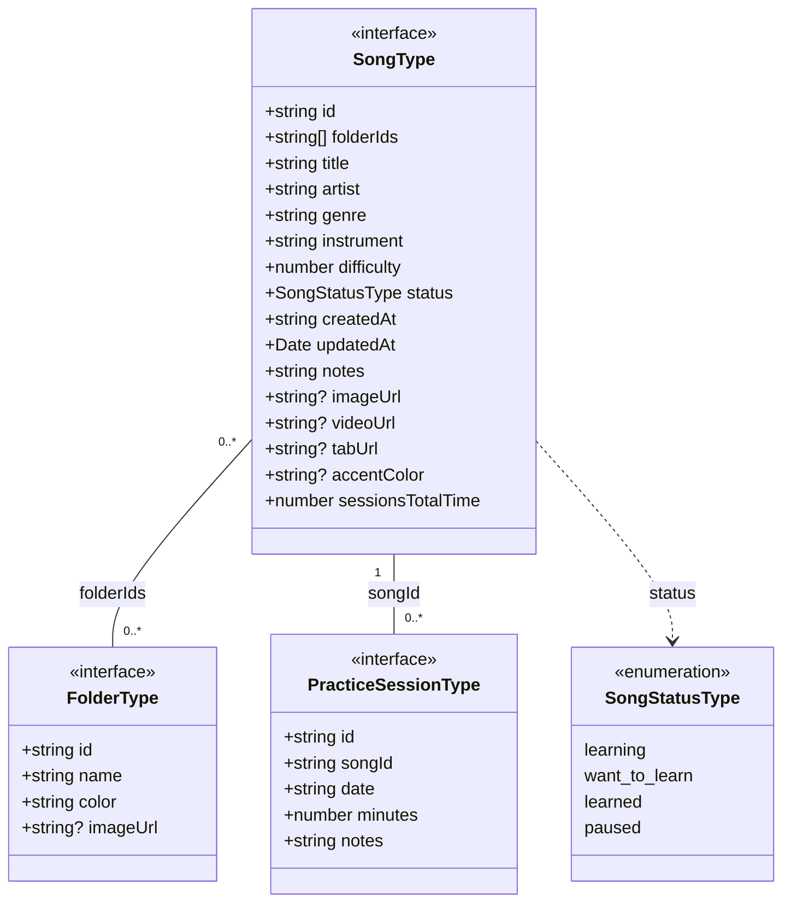

# Arquitetura e diagramas de classes do Track Log

O Track Log organiza um repertório musical em pastas e registra sessões de prática. A persistência usa PostgreSQL com Prisma; a interface recebe projeções desses registros por meio de interfaces TypeScript.

Os diagramas abaixo usam Mermaid `classDiagram`, renderizado diretamente pelo GitHub. O código do diagrama fica neste documento e pode ser atualizado junto ao schema e aos tipos. São modelos de dados representados em UML, e não classes implementadas em runtime.

## Fontes de referência

| Fonte                                                        | Conteúdo                                                       |
| ------------------------------------------------------------ | -------------------------------------------------------------- |
| [Schema Prisma](../prisma/schema.prisma)                     | Entidades, enum, chaves, índices e relacionamentos persistidos |
| [Tipos da aplicação](../src/data/types/index.ts)             | Contratos usados pela interface                                |
| [Tipos dos registros](../src/lib/prisma-types.ts)            | Tipos derivados dos modelos Prisma                             |
| [Mappers](../src/utils/mappers.ts)                           | Conversão dos registros para os contratos da aplicação         |
| [Autenticação](../src/lib/auth.ts)                           | Resolução do usuário a partir do token Firebase validado       |
| [Associações de pastas](../src/actions/songs/folderUtils.ts) | Validação da propriedade e sincronização das associações       |

## Modelo persistido

Neste diagrama, `String?` identifica um campo que aceita `null`. As coleções e referências de relacionamento aparecem nas associações entre as classes.

### Relacionamentos e restrições

- Uma música pode estar em nenhuma ou várias pastas; uma pasta pode conter nenhuma ou várias músicas. `SongFolder` materializa essa relação muitos-para-muitos.
- A chave primária de `SongFolder` é composta por `songId` e `folderId`, impedindo associações duplicadas.
- Uma sessão pertence exatamente a uma música. Uma música pode não ter sessões ou ter várias.
- Excluir uma música remove suas sessões e associações com pastas por `onDelete: Cascade`. Excluir uma pasta remove as associações; as músicas continuam existindo.
- `Song`, `Folder` e `PracticeSession` usam IDs gerados com `cuid()`. Datas de criação e de sessão usam `now()`; `updatedAt` é atualizado pelo Prisma.
- Há índices de `userId` em músicas e pastas; de `songId` e `folderId` em `SongFolder`; e de `songId` e `date` em sessões.
- A dificuldade de uma música deve ficar entre 1 e 5 e a duração de uma sessão entre 1 e 180 minutos, conforme os [schemas Zod](../src/data/schemas). Esses limites são validados pela aplicação, não declarados como restrições neste schema Prisma.

### Propriedade dos dados

Não existe uma entidade `User` no schema atual. `userId` é a identidade Firebase validada pelo servidor e é armazenada como texto em `Song` e `Folder`; não é uma chave estrangeira para uma tabela local de usuários.

`PracticeSession` e `SongFolder` não têm `userId` próprio. As actions verificam a propriedade da música e das pastas envolvidas. O schema não declara uma restrição de banco que garanta igualdade entre os usuários de uma música e de uma pasta; essa verificação pertence à aplicação.

## Contratos usados pela interface

As interfaces são projeções dos registros persistidos. `string?` indica um atributo opcional, que pode ser omitido ou ter valor `undefined` no contrato TypeScript.

As associações deste segundo diagrama são lógicas: `SongType` contém IDs de pastas e `PracticeSessionType` contém o ID da música, sem referências diretas aos objetos relacionados. `SongStatusType` é uma união de strings TypeScript, representada como enumeração para exibir seus valores.

### Conversões e campos derivados

| Registro persistido            | Contrato da interface             | Conversão                                                                          |
| ------------------------------ | --------------------------------- | ---------------------------------------------------------------------------------- |
| `Folder`                       | `FolderType`                      | Omite `userId` e timestamps; transforma `imageUrl: null` em `undefined`            |
| `Song` e suas associações      | `SongType`                        | Recebe `folderIds` e `sessionsTotalTime` como argumentos do mapper; omite `userId` |
| `Song.createdAt`               | `SongType.createdAt`              | Converte a data para uma string de data por `toDateOnlyString`                     |
| `Song.updatedAt`               | `SongType.updatedAt`              | Preserva o tipo `Date` no contrato                                                 |
| URLs e cor opcionais de `Song` | Atributos opcionais de `SongType` | Converte `null` em `undefined`                                                     |
| `PracticeSession`              | `PracticeSessionType`             | Converte `date` para string de data; omite timestamps de auditoria                 |

`sessionsTotalTime` não é uma coluna de `Song` e não é calculado automaticamente pelo mapper: o valor é fornecido pelo chamador, com padrão `0`. `folderIds` também é fornecido ao mapper a partir das associações; não é uma coluna do modelo persistido.

## Organização do código

As rotas de `src/app` carregam dados e compõem as telas. As features dividem apresentação, composição e lógica de interface entre `components`, `container` e `hooks`. As Server Actions de `src/actions` fazem a leitura e alteração dos dados com autenticação, validação e invalidação de cache. Os mappers convertem registros Prisma nos contratos usados pela interface.

As orientações de implementação ficam centralizadas no [AGENTS.md](../AGENTS.md). Na revisão da tarefa ORG-163, não havia `.cursor` nem `.cursorrules` no checkout ou no histórico Git disponível; a consolidação foi feita a partir dos padrões atuais do código e das instruções do projeto.

## Atualização dos diagramas

1. Ao alterar `prisma/schema.prisma`, ajuste o modelo persistido, suas cardinalidades e a descrição de chaves e cascatas.
2. Ao alterar `src/data/types/index.ts` ou `src/utils/mappers.ts`, ajuste os contratos e a tabela de conversões.
3. Confira se valores opcionais, enumerações e campos derivados continuam representados corretamente.
4. Visualize os blocos Mermaid no GitHub ou em um visualizador compatível; não é necessário adicionar dependências ao aplicativo.
